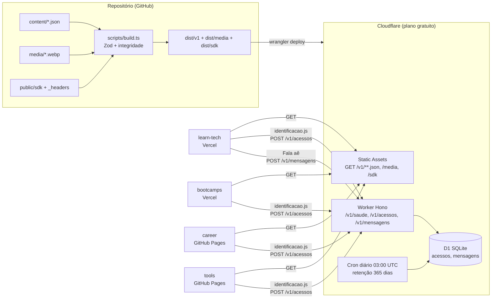

# Arquitetura do learntech-content

## Visão geral

## Camadas

| Camada | Onde | Responsabilidade |
|---|---|---|
| Conteúdo | `content/` | Fonte da verdade, um JSON por programa e por evento, listas para career e tools |
| Schemas | `src/schemas/` | Formato de cada recurso (Zod). É o contrato com os frontends |
| Build | `scripts/` | Valida schema e integridade, gera `dist/`, `index.json` e `openapi.json` |
| Borda | Static Assets | Serve a leitura com cache (`public/_headers`) |
| API dinâmica | `src/app.ts`, `src/worker.ts` | Saúde, registro de acesso, mensagens do "Fala aê", administração e retenção |
| Persistência | `src/acessos/`, `src/mensagens/` | Portas `RepositorioAcessos` e `RepositorioMensagens`, cada uma com adaptador D1 e adaptador em memória para testes |
| SDK | `public/sdk/identificacao.js` | Formulário de identificação em Shadow DOM, usado pelos 4 sites |

## Fluxo de leitura

1. O site pede `GET /v1/...json`.
2. A Cloudflare responde do cache de borda, com `Cache-Control: max-age=300, stale-while-revalidate=86400` e `Access-Control-Allow-Origin: *`.
3. Se a API estiver fora do ar, o site usa os dados locais que já tem no bundle (ADR 5). A API nunca derruba um site.

## Fluxo de identificação

1. O site carrega `https://<api>/sdk/identificacao.js` com `data-projeto`.
2. Sem identificação guardada no navegador, o script mostra o formulário (nome completo e e-mail) com o texto de finalidade e o link da política.
3. Com identificação, faz um `POST /v1/acessos` por sessão do navegador.
4. O Worker valida origem (lista `ALLOWED_ORIGINS`), corpo (Zod) e, se configurado, o Turnstile. Ignora repetição do mesmo e-mail no mesmo projeto em 30 minutos e grava no D1.
5. Um cron diário apaga registros com mais de `RETENCAO_DIAS`.

## Fluxo do "Fala aê"

1. O formulário do learn-tech faz `POST /v1/mensagens` com nome completo, e-mail, motivo, mensagem, projeto e página.
2. O Worker aplica as mesmas proteções do registro de acesso (origem, limite de corpo, Zod e Turnstile quando configurado). Ignora a mesma mensagem do mesmo e-mail repetida em 10 minutos e grava na tabela `mensagens`.
3. A equipe lê por `GET /v1/mensagens` (token) e responde por e-mail. O cron diário aplica a mesma retenção.

## Limites do plano gratuito (setembro de 2026)

| Recurso | Limite gratuito | Uso esperado |
|---|---|---|
| Workers | 100 mil requisições/dia, 10 ms de CPU por requisição | Só `/v1/acessos` e `/v1/saude` contam como invocação de Worker; leitura estática é servida pelos Static Assets |
| Static Assets | 20 mil arquivos, 25 MiB por arquivo | ~120 arquivos, 3,8 MB |
| D1 | 5 GB, 5 milhões de linhas lidas/dia, 100 mil escritas/dia | Uma linha por pessoa, por site, por sessão |
| Cron Triggers | Incluídos | 1 por dia |

## Qualidade

- TypeScript estrito (`noUncheckedIndexedAccess`).
- 30 testes (Vitest): schema e integridade do conteúdo real, erros plantados, rotas, CORS, deduplicação, CSV, LGPD e retenção.
- CI no GitHub Actions: typecheck, testes e build a cada push.
- Teste de fumaça feito com `wrangler dev` e D1 local: leitura, mídia, SDK, POST, deduplicação, CORS, administração, CSV, exclusão e cron.
