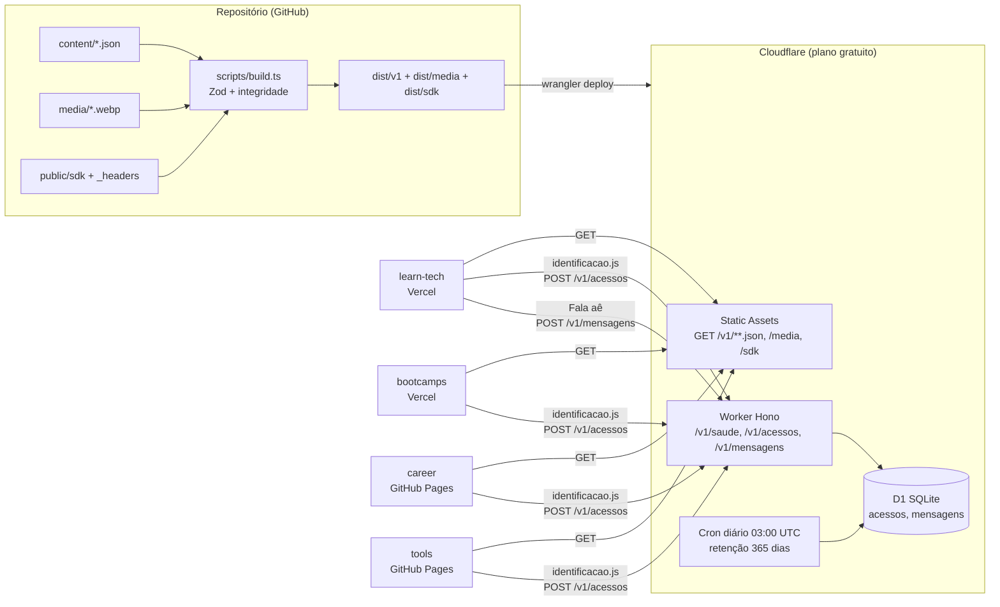

# Arquitetura do learntech-content

## Visão geral

## Camadas

| Camada | Onde | Responsabilidade |
|---|---|---|
| Conteúdo | `content/` | Fonte da verdade, um JSON por programa e por evento, listas para career e tools |
| Schemas | `src/schemas/` | Formato de cada recurso (Zod). É o contrato com os frontends |
| Build | `scripts/` | Valida schema e integridade, gera `dist/`, `index.json` e `openapi.json` |
| Borda | Static Assets | Serve a leitura com cache (`public/_headers`) |
| API dinâmica | `src/app.ts`, `src/worker.ts` | Saúde, registro de acesso, mensagens do "Fala aê", administração e retenção |
| Persistência | `src/acessos/`, `src/mensagens/` | Portas `RepositorioAcessos` e `RepositorioMensagens`, cada uma com adaptador D1 e adaptador em memória para testes |
| SDK | `public/sdk/identificacao.js` | Formulário de identificação em Shadow DOM, usado pelos 4 sites |

## Fluxo de leitura

1. O site pede `GET /v1/...json`.
2. A Cloudflare responde do cache de borda, com `Cache-Control: max-age=300, stale-while-revalidate=86400` e `Access-Control-Allow-Origin: *`.
3. Se a API estiver fora do ar, o site usa os dados locais que já tem no bundle (ADR 5). A API nunca derruba um site.

## Fluxo de identificação

1. O site carrega `https://<api>/sdk/identificacao.js` com `data-projeto`.
2. Sem identificação guardada no navegador, o script mostra o formulário (nome completo e e-mail) com o texto de finalidade e o link da política.
3. Com identificação, faz um `POST /v1/acessos` por sessão do navegador.
4. O Worker valida origem (lista `ALLOWED_ORIGINS`), aplica o limite de taxa por IP (binding `LIMITADOR_ESCRITA`, 30 por 60 s; acima disso, 429), valida o corpo (Zod) e, se configurado, o Turnstile. Ignora repetição do mesmo e-mail no mesmo projeto em 30 minutos e grava no D1.
5. Um cron diário apaga registros com mais de `RETENCAO_DIAS`.

## Fluxo do "Fala aê"

1. O formulário do learn-tech faz `POST /v1/mensagens` com nome completo, e-mail, motivo, mensagem, projeto e página.
2. O Worker aplica as mesmas proteções do registro de acesso (origem, limite de taxa por IP, limite de corpo, Zod e Turnstile quando configurado). Ignora a mesma mensagem do mesmo e-mail repetida em 10 minutos e grava na tabela `mensagens`.
3. A equipe lê por `GET /v1/mensagens` (token) e responde por e-mail. O cron diário aplica a mesma retenção.

## Limites do plano gratuito (setembro de 2026)

| Recurso | Limite gratuito | Uso esperado |
|---|---|---|
| Workers | 100 mil requisições/dia, 10 ms de CPU por requisição | Só `/v1/acessos*`, `/v1/mensagens` e `/v1/saude` contam como invocação de Worker (lista `run_worker_first`); leitura estática é servida pelos Static Assets |
| Static Assets | 20 mil arquivos, 25 MiB por arquivo | 291 arquivos e 15 MB em `dist/`, dos quais 11 MB de mídia (medido em 03/11/2026 com `du -sh dist`) |
| Rate limiting (binding) | Incluído | 30 escritas por 60 s por IP e rota |
| D1 | 5 GB, 5 milhões de linhas lidas/dia, 100 mil escritas/dia | Uma linha por pessoa, por site, por sessão |
| Cron Triggers | Incluídos | 1 por dia |

## Qualidade

- TypeScript estrito (`noUncheckedIndexedAccess`).
- 102 testes (Vitest) em 5 arquivos, em 03/11/2026 (`npm test` dá o número atual):
  - `conteudo.test.ts`: schema e integridade do conteúdo real, erros plantados e OpenAPI;
  - `acessos.test.ts` e `mensagens.test.ts`: rotas, CORS, Turnstile, deduplicação, limite de taxa (429), CSV, LGPD (DELETE com e-mail no corpo) e retenção;
  - `worker.test.ts`: roteamento Hono × Static Assets, coerência com `run_worker_first` e `ratelimits` do `wrangler.jsonc`, e o caminho POST → D1 → GET;
  - `repositorio-d1.test.ts`: o SQL real dos adaptadores D1 contra SQLite (`node:sqlite`) com as migrações aplicadas. O D1 é simulado por `tests/apoio/d1-sqlite.ts`, cujos limites estão descritos no próprio arquivo.
- CI no GitHub Actions (`ci.yml`): typecheck, lint, testes e build a cada push e pull request.
- Deploy (`deploy.yml`): só depois da CI verde num push na `main` (`workflow_run`), com o commit que a CI verificou; sem os segredos da Cloudflare, o job falha em vez de terminar verde sem publicar.

## Fluxo de publicação

1. Commits por tema na branch do dia `feature/tasks-DD-MM-AAAA`, com os arquivos adicionados pelo nome.
2. Push da branch; a CI (`verificar`) precisa ficar verde no commit da ponta.
3. `developer`: `merge --ff-only` da branch e push.
4. `main`: `merge --ff-only` da branch e push. O ruleset `main protegida` só aceita commit que passou no `verificar`, por isso nunca `--no-ff`.
5. O push na `main` roda a CI de novo e, com ela verde, o `deploy.yml` aplica as migrações do D1 e publica.

Detalhes em `docs/processo/fluxo-git.md`; `scripts/publicar.sh` faz os passos 2 a 4.
- Teste de fumaça feito com `wrangler dev` e D1 local: leitura, mídia, SDK, POST, deduplicação, CORS, administração, CSV, exclusão e cron.
