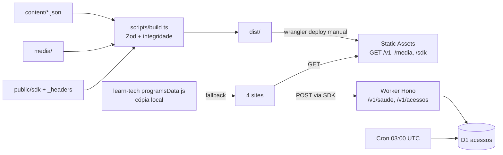
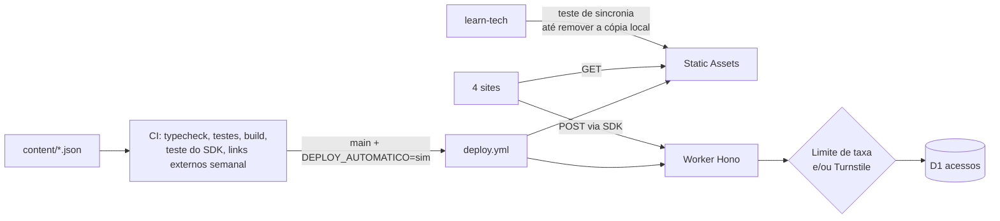

# 02 · Plano e arquitetura — learntech-content

## 1. Arquitetura atual

Pontos de atenção na arquitetura atual: deploy só manual (o workflow automático está vazio), escrita sem limite de taxa, e uma segunda cópia do catálogo no learn-tech sem checagem de sincronia.

## 2. Arquitetura alvo (proposta)

## 3. Decisões (ADR curto)

Numeração continua a de `docs/DECISOES.md` só como sugestão; nenhuma foi incorporada lá.

| ADR | Contexto | Decisão proposta | Consequência | Situação |
|---|---|---|---|---|
| 9 — Deploy automático explícito | `deploy.yml` tem 0 bytes; DEPLOY.md descreve push na `main` → testar → publicar, condicionado a `DEPLOY_AUTOMATICO=sim` | Recriar o workflow conforme a doc, com `npm run verificar`, `db:migrar:remoto` e `wrangler deploy`, ou remover a seção da doc | Publicação reprodutível; exige os secrets `CLOUDFLARE_API_TOKEN` e `CLOUDFLARE_ACCOUNT_ID` | Proposta, aguarda dono |
| 10 — Proteção da escrita | `POST /v1/acessos` aceita qualquer cliente que forje `Origin` | Ligar Turnstile em produção **ou** limitar taxa por IP no Worker (binding de rate limit da Cloudflare, sem gravar IP) | Métrica mais confiável; a política de privacidade precisa citar o uso transitório do IP | Proposta, decisão de produto (P1) |
| 11 — Origens de produção | `localhost:*` está em `ALLOWED_ORIGINS` de produção | Mover localhost para `.dev.vars`/`env.dev` do wrangler | Desenvolvimento local continua; produção aceita só os 4 domínios | Proposta |
| 12 — Fonte única do catálogo | Catálogo em dois repositórios | Teste no learn-tech que compara `programsData.js` com `/v1/learn-tech/programas.json` (ids e títulos) até a cópia local ser removida (ADR 5) | Divergência vira erro de CI | Proposta, envolve o outro repositório |

## 4. Plano em lotes

Esforço é **estimativa**. "Muda o produto?" = altera conteúdo, texto visível, regra de negócio ou comportamento percebido.

### Lote 1 — executado nesta revisão (engenharia, sem mudar o produto)

| ID | Item | Motivo | Arquivos | Critério de pronto | Esforço | Risco | Muda o produto? | Situação |
|---|---|---|---|---|---|---|---|---|
| L1.1 | Escapar o link da política antes de inserir em `innerHTML` | Atributo `data-privacidade` entrava cru no HTML | public/sdk/identificacao.js | `node --check` passa; formulário abre e o link aponta para a mesma URL | 10 min | Muito baixo | Não | Feito |
| L1.2 | Corrigir instrução desatualizada do `database_id` | DEPLOY.md citava um marcador que não existe mais | docs/DEPLOY.md | Texto bate com wrangler.jsonc | 5 min | Nenhum | Não | Feito |
| L1.3 | Documentação da revisão e roteiros de teste | Registrar avaliação, plano e verificação | docs/claudeia/* | 5 documentos + verificar.ps1 presentes | 2 h | Nenhum | Não | Feito |
| L1.4 | CI | Já existe e só roda scripts do package.json | .github/workflows/ci.yml | — | — | — | Não | Mantido sem alteração |

Itens permitidos que **não se aplicam** aqui: `lang`/meta description (não há HTML neste repositório); try/catch em localStorage/JSON.parse (o SDK já protege, identificacao.js:27-40); erro que quebra build (nenhum encontrado na leitura; confirmar com `verificar.ps1`).

### Lote 2 — engenharia, precisa do dono (credenciais ou validação)

| ID | Item | Motivo | Arquivos | Critério de pronto | Esforço | Risco | Muda o produto? | Situação |
|---|---|---|---|---|---|---|---|---|
| L2.1 | Recriar ou remover `deploy.yml` (ADR 9) | Arquivo vazio; possível erro no Actions | .github/workflows/deploy.yml, docs/DEPLOY.md | Actions sem erro; deploy em push na `main` só com `DEPLOY_AUTOMATICO=sim` | 1 h | Médio (publica em produção) | Não | Proposta |
| L2.2 | Tirar localhost das origens de produção (ADR 11) | Superfície desnecessária | wrangler.jsonc, .dev.vars.example | `wrangler dev` aceita localhost; produção recusa | 30 min | Baixo | Não | Proposta |
| L2.3 | Testes do SDK com jsdom/happy-dom | Código que roda nos 4 sites sem teste | tests/sdk.test.ts, package.json | Testes cobrem: sem identificação mostra formulário; com identificação registra 1x por sessão; storage bloqueado não quebra | 3 h | Baixo | Não | Proposta (exige dependência nova) |
| L2.4 | Dedupe atômico | Duas abas simultâneas geram 2 linhas | src/acessos/repositorio-d1.ts, migration nova | `INSERT ... WHERE NOT EXISTS` em um comando; testes passam | 1 h | Baixo | Não | Proposta |
| L2.5 | Paginação na exportação (`?depois=id`) | Limite de 1.000 linhas | src/app.ts, openapi.ts, testes | Exporta tudo em páginas | 1 h | Baixo | Não | Proposta |
| L2.6 | Verificação semanal de links externos | 208 URLs sem checagem | scripts/links.ts, workflow agendado | Relatório de 4xx/5xx sem falhar o build | 2 h | Baixo | Não | Proposta |
| L2.7 | Lint (ESLint + typescript-eslint) | Padronização | package.json, eslint.config.js | `npm run lint` no CI | 1 h | Baixo | Não | Proposta (dependência nova) |
| L2.8 | Teste de sincronia com o learn-tech (ADR 12) | Catálogo duplicado | repositório learn-tech | CI falha se ids/títulos divergirem | 2 h | Baixo | Não | Proposta (outro repositório) |
| L2.9 | Limite de taxa ou Turnstile em produção (ADR 10) | Escrita aberta | src/app.ts, wrangler.jsonc | Rajada de POSTs de um mesmo cliente recebe 429 | 2 h | Médio | Indireto (P1) | Proposta |

### Lote 3 — decisões de produto (não executar sem aprovação)

| ID | Item | Motivo | Arquivos | Critério de pronto | Esforço | Risco | Muda o produto? | Situação |
|---|---|---|---|---|---|---|---|---|
| L3.1 | Aperfeiçoar o formulário obrigatório, **mantendo-o** | Feedback de envio, foco e falha de rede | public/sdk/identificacao.js | Botão mostra "Enviando…"; foco volta ao fechar; falha de rede avisa e permite seguir | 2 h | Baixo | Sim (texto/comportamento visível) | Proposta |
| L3.2 | Painel de resumo para o dono | A métrica justifica o formulário, mas só existe via curl | página estática com token digitado, ou rota admin | Dono vê totais por projeto/dia sem terminal | 4 h | Médio (token no navegador) | Sim | Proposta |
| L3.3 | Texto da política × Turnstile/IP | Coerência legal | content/learn-tech/paginas/privacidade.json, docs/PRIVACIDADE.md | Texto descreve o que de fato ocorre | 30 min | Baixo | Sim | Proposta |
| L3.4 | E-mail de contato de privacidade | Pendência do dono | privacidade.json, learn-tech privacyData.js | E-mail publicado nos dois lugares | 15 min | Baixo | Sim | Proposta |
| L3.5 | Revisão de curadoria (Polywork, Data Studio, Mockingbird e outros) | Possível conteúdo desatualizado | content/career, content/tools | Itens confirmados, renomeados ou retirados | 1 h | Baixo | Sim | Proposta |
| L3.6 | Plano para os 30 programas sem módulos | Profundidade desigual | content/learn-tech/programas | Lista priorizada ou sinalização nos cards | — | — | Sim | Proposta |
| L3.7 | Licença | Ausente | LICENSE | Arquivo na raiz | 15 min | Nenhum | Sim (termos) | Proposta |
