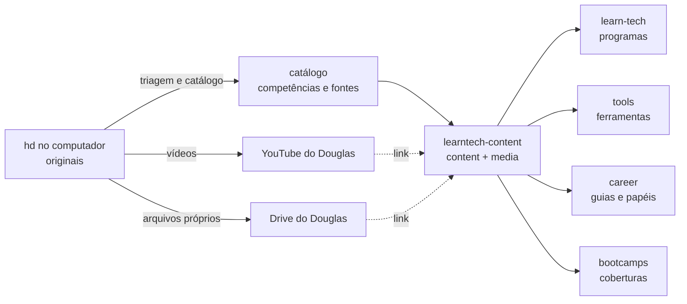

# Ecossistema LearnTECH

Documentação do processo que transforma o acervo bruto (`hd`, no computador do Douglas) em conteúdo publicado pela API (`learntech-content`) nos quatro sites: learn-tech, tools, career e bootcamps.

Gerado em 27/10/2026. Os documentos 01 a 07 são análise e proposta. O 08 registra o piloto executado, que alterou só conteúdo (`content/`, `media/`) e acrescentou `scripts/tratar-fotos.py`. O 09 registra o primeiro lote de conteúdo. O 12 registra a primeira mudança de código nos sites: as páginas de detalhe.

## Documentos

| Arquivo | Conteúdo | Estado |
|---|---|---|
| `01-inventario-documentos.md` | 92 arquivos de `hd/blogs-pdf-docs` em 60 ids (DOC-nnn): direitos, temas, estratégia e destinos | Concluído; 18 dúvidas |
| `01-inventario-eventos.md` | 682 arquivos de `hd/eventos` em 7 ids (EV-nnn): pesquisa dos eventos, roteiro das páginas de cobertura, 178 fotos candidatas | Concluído; 14 dúvidas |
| `02-contratos.md` | O que cada site consome da API, campo a campo, e 16 divergências | Concluído |
| `03-modelo-canonico.md` | Competência, ferramenta, papel, programa, evento, artigo e fonte, com as relações e validações | Proposta |
| `04-matriz-conteudo.md` | Cada competência nos 4 sites e as ondas de execução | Proposta |
| `05-metodo.md` | Funil do bruto ao publicado, armazenamento e receita para cada formato | Proposta |
| `06-conferencia.md` | Feito e falta nos 5 projetos (engenharia, UX, design, testes, conteúdo) | Concluído |
| `07-validar.md` | Todas as decisões pendentes, com a segurança no topo | Aguardando o Douglas |
| `08-piloto-codexperience.md` | Piloto executado: fotos, evento, artigo, catálogo, como ver e como ajustar | Concluído |
| `10-uso-do-hd.md` | O que foi usado do hd e o que ainda rende | Concluído |
| `11-mapa-editorial.md` | Cada item do hd classificado nos 7 tipos de conteúdo, com a fila de prioridade | Concluído |
| `12-paginas-de-detalhe.md` | Páginas de detalhe no career, no tools e no bootcamps, com verificação e decisões | Concluído |
| `09-relatorio-2026-10-28.md` | Primeiro lote: 3 programas, 13 artigos, tools, career, Startup Way, decisões a revisar | Concluído |

## Fluxo

## Próximo passo

O piloto da onda 1 já foi executado (`08-piloto-codexperience.md`). Para publicá-lo:

1. O Douglas resolve as seções 1 e 2 de `07-validar.md` (segurança e commit).
2. As decisões do piloto (E1, E3 e E8) foram resolvidas pelo Douglas em 27/10/2026. As demais seguem em `07-validar.md`.
3. Valide o piloto (`08-piloto-codexperience.md`, seção 4) e publique. Depois vem a onda 2, com os guias do career.
