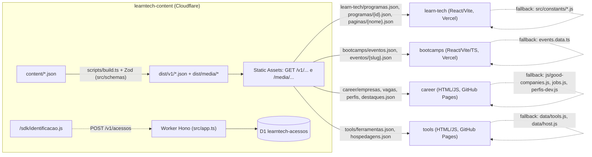

# 02 · Contratos de dados do ecossistema LearnTECH

Levantamento de 27/10/2026, feito só por leitura de arquivos (sem build, sem npm, sem acesso à API publicada). Caminhos relativos à pasta `mundo-learn-tech/`. "Usado onde" cita arquivo e linha do consumidor; "no schema?" compara com `learntech-content/src/schemas/*.ts`.

Legenda da coluna "Obrigatório na tela": **sim** = a tela quebra ou fica sem sentido sem o campo; **cond.** = só aparece quando existe; **não** = não é exibido.

---

## 1. Visão geral

| Site | Cliente da API | Variável/URL | Tempo limite | Estado da ligação hoje |
|---|---|---|---|---|
| learn-tech | `src/services/conteudo.js` | `VITE_API_URL` (`conteudo.js:6`; `.env.example` só com marcador) | 5 s (`conteudo.js:7`) | Depende da variável na Vercel (não verificável daqui) |
| bootcamps | `src/shared/api/learntechContent.ts` + `src/entities/event/api/eventApi.ts` | `VITE_API_URL` (`learntechContent.ts:3`) | 5 s (`learntechContent.ts:4`) | Depende da variável na Vercel |
| career | `js/api.js` + `js/catalog.js` | `js/config.js:3` = `https://learntech-content.SEU-SUBDOMINIO.workers.dev` | 5 s (`api.js:6`); espera 1,5 s antes do 1º render (`main.js:8,12`) | **Desligada**: `api.js:5` zera `BASE` quando a URL contém `SEU-SUBDOMINIO` |
| tools | `js/api.js` + `main.js` | `js/config.js:3` (mesmo marcador) | 5 s (`api.js:6`); corte de 2,5 s (`main.js:8,31`) | **Desligada** pelo mesmo motivo |

Regras comuns aos quatro clientes:

- Todos fazem `GET ${API}/v1/{caminho}` e caem nos dados locais se a API falhar, demorar ou responder fora do formato.
- Todos trocam strings que começam com `/media/` pela URL absoluta da API (`conteudo.js:37-39`, `learntechContent.ts:21-28`, `career/js/api.js:23-25`, `tools/js/api.js:23-25`). Em career e tools a troca vale **só para o campo `thumb`**.
- Todos injetam `${API}/sdk/identificacao.js` com `data-projeto` (`learn-tech/src/services/identificacao.js:5-14`, `learntechContent.ts:31-40`, `career/js/api.js:33-42`, `tools/js/api.js:33-42`). Nenhum `index.html` traz a tag do script, embora `docs/DEPLOY.md:39-46` mande editar "o script em `index.html`" (ver seção 4).

### Navegação e links cruzados

| De → Para | learn-tech | bootcamps | career | tools |
|---|---|---|---|---|
| **learn-tech** | — | `src/pages/about/About.jsx:133` | `src/pages/career/Career.jsx:134` | `src/pages/recursos/Recursos.jsx:224` |
| **bootcamps** | só a URL da política no SDK (`learntechContent.ts:38`), sem link visível | — | não | não |
| **career** | só a URL da política no SDK (`js/api.js:40`), sem link visível | não | — | não |
| **tools** | `index.html:178` (rodapé) | não | não | — |

Só o learn-tech funciona como "hub". bootcamps e career não apontam para nenhum outro site do ecossistema; tools aponta só para o learn-tech.

---

## 2. Contratos por site

### 2.1 learn-tech

**Rotas** (`src/App.jsx:121-151`): `/`, `/programs`, `/privacy`, `/terms`, `/careers`, `/aprender`, `/blog/:id`, `/softskills`, `/mentorias`, `/resources`, `/about`, `/falaae`, `/category`, `/program/:category/:id`, `/program/:category/:id/enroll`, `*` (404). Menu vindo da API: `content/learn-tech/paginas/navegacao.json` (Home, Programas, Recursos, Learn TECH, Fala aê). Rodapé: `src/components/footer/Footer.jsx:13-90`.

**Endpoints consumidos**

| Endpoint | Hook | Onde | Fallback local |
|---|---|---|---|
| `/v1/learn-tech/programas.json` | `useProgramas` (`conteudo.js:91-93`) | `pages/home/programs/Programs.jsx:9`, `pages/programs/Programs.jsx:7` | `src/constants/programsData.js` (33 programas) |
| `/v1/learn-tech/programas/{id}.json` | `usePrograma` (`conteudo.js:96-100`) | `pages/detail/Detail.jsx:23`, `pages/enroll/EnrollPrograms.jsx:36` | item de `programsData.js` |
| `/v1/learn-tech/paginas/navegacao.json` | `usePagina` | `components/nav/Navbar.jsx:10` | `constants/navbarData.js` |
| `/v1/learn-tech/paginas/sobre.json` | idem | `pages/about/About.jsx:8` | `constants/aboutData.js` |
| `/v1/learn-tech/paginas/aprender.json` | idem | `pages/aprender/Aprender.jsx:8` | `constants/aprenderData.js` |
| `/v1/learn-tech/paginas/carreira.json` | idem | `pages/career/Career.jsx:8` | `constants/careerData.js` |
| `/v1/learn-tech/paginas/privacidade.json` / `termos.json` | idem | `pages/docs/Privacidade.jsx:7`, `pages/docs/Termos.jsx:7` | `privacyData.js`, `termsData.js` |
| `/v1/learn-tech/paginas/faq.json` | idem | `pages/falaae/FalaAe.jsx:53` | `falaaeData.js` |
| `/v1/learn-tech/paginas/blog.json` | idem | `pages/home/blog/Blog.jsx:9`, `BlogOne.jsx:9` | `blogData.js` |
| `/v1/learn-tech/paginas/categorias.json` | idem | `pages/home/category/Category.jsx:9` | `categoriesData.js` |
| `/v1/learn-tech/paginas/estatisticas.json` | idem | `pages/home/stats/Stats.jsx:7` | `statsData.js` |
| `/v1/learn-tech/paginas/mentorias.json` | idem | `quickaccess/mentorias/Mentorias.jsx:7`, `softskills/Softskills.jsx:7` | `premiosData.js` |

Hidratação (`conteudo.js:42-49`): campo chamado `icon` com nome conhecido vira componente React; `/media/...` vira URL absoluta. Para programas, `comMidiaLocal` (`conteudo.js:84-88`) completa `video`, `videoPoster` e `image` com o dado local quando a API não tem (o programa 1 na API tem `video: null`; o vídeo do YouTube só existe em `programsData.js:5`).

**Recurso: programa (card) — `programas.json`** (resumo gerado por `CAMPOS_RESUMO`, `src/schemas/learn-tech.ts:73-76`, mais `modulesCount` e `hasQuiz`, `scripts/lib/conteudo.ts:201-207`)

| Campo | Tipo | Usado onde | Obrigatório na tela | No schema? |
|---|---|---|---|---|
| `id` | number | link do card, `ProgramsCard.jsx:93` | sim (PropTypes `isRequired`, `:109`) | sim |
| `image` | string (URL ou `/media/`) | ``, `ProgramsCard.jsx:31` | sim (`:110`) | sim, opcional e anulável |
| `category` | string | selo, `ProgramsCard.jsx:43`; filtro e busca, `pages/programs/Programs.jsx:9,25-26` | sim | sim |
| `categoryFilter` | string slug | rota `/program/{categoryFilter}/{id}` (`ProgramsCard.jsx:93`); agrupamento na Home (`home/programs/Programs.jsx:12`) | sim | sim |
| `title` | string | `ProgramsCard.jsx:32,54`; busca | sim | sim |
| `lessons` | string | `ProgramsCard.jsx:61` | sim (PropTypes) | sim, opcional |
| `duration` | string | `ProgramsCard.jsx:66` | sim (PropTypes) | sim, opcional |
| `access` | string | `ProgramsCard.jsx:82` | sim (PropTypes) | sim, opcional |
| `accessType` | string (`membros` muda o selo) | `ProgramsCard.jsx:19` | não | sim, opcional (só 4 programas têm) |
| `status` | `lancado` / `novidade` | `ProgramsCard.jsx:20,84-101`: `novidade` mostra "Em breve" e cinza; ausente mostra "Aprenda" | sim (PropTypes `isRequired`, `:118`) | **não** (ver D1) |
| `level`, `description`, `video`, `videoPoster` | string | não usados no card | não | sim |
| `modulesCount`, `hasQuiz` | number, boolean | **nenhum uso** em `src/` | não | gerados pelo build |

**Recurso: programa completo — `programas/{id}.json`**

| Campo | Tipo | Usado onde | Obrigatório na tela | No schema? |
|---|---|---|---|---|
| `title`, `duration`, `category`, `categoryFilter`, `id`, `image`, `lessons` | — | `pages/detail/Detail.jsx` (título `:38,47`, duração `:52`, categoria `:60`, imagem `:77`) | sim | sim |
| `level`, `description` | string | `Detail.jsx` (classe por nível `:15-22`) | cond. | sim |
| `about`, `letslearn`, `materials`, `curriculum` | string / lista | `Detail.jsx`; `curriculum` também em `EnrollPrograms.jsx:97` | cond. | **não declarados** (passam por `looseObject`) |
| `whatYouBuild`, `whyNow`, `appliedIn`, `forWho`, `marketUsage` | objetos (`title`, `items`/`paragraphs`/`profiles`/`companies`...) | `Detail.jsx` | cond. | **não declarados** |
| `sources[]` (`label`, `url`) | lista | `Detail.jsx` | cond. | sim |
| `enrollDetails` (`moduleOverviews[].moduleId/title/items`, `label`, `description`, `text`) | objeto | `pages/enroll/Description.jsx:13-14` (sem ele a página fica em "Carregando conteúdo...") | sim para a página de treinamento | **não declarado**; o build só confere `moduleOverviews[].title` (`scripts/lib/conteudo.ts:145-146`) |
| `modules[]` (`id`, `title`, `lessonsCount`, `component`) | lista | `EnrollPrograms.jsx:100-115`, `tabContent/TabContent.jsx` | sim no treinamento | sim; `lessonsCount` e `component` **não são exibidos** (só testados) |
| `moduleContents[]` (`id`, `icon`, `title`, `sections[].subsections[]`, `highlights[]`...) | lista | `tabContent/TabContent.jsx`, `ModuleRenderer.jsx` | sim no treinamento | sim |
| `quiz[]` (`id`, `moduleId`, `question`, `explanation`, `options[].text/isCorrect`) | lista | `EnrollPrograms.jsx`, `quiz/Quiz.jsx` | cond. | sim |
| `video`, `videoPoster` | string | `EnrollPrograms.jsx` (player) | cond. | sim |

**Recurso: páginas** — `paginaSchema = z.record(z.string(), z.unknown())` (`learn-tech.ts:78`): a API só garante que as 11 páginas existem (`PAGINAS`, `:80-83`), não o formato. Chaves desestruturadas pelas telas, todas presentes nos JSON de `content/learn-tech/paginas/`:

| Página | Chaves usadas | Onde |
|---|---|---|
| `sobre` | `heroContent`, `processSteps`, `philosophyQuote`, `differentiators` | `About.jsx:8` |
| `aprender` | `heroContent`, `techniques`, `closingQuote`, `sources` | `Aprender.jsx:8` |
| `carreira` | `heroContent`, `planningPoints`, `platforms`, `closingText` | `Career.jsx:8` |
| `privacidade`, `termos` | `lastUpdated`, `sections` | `Privacidade.jsx:7`, `Termos.jsx:7` |
| `mentorias` | `mentoriasData`, `softSkillsData` | `Mentorias.jsx:7`, `Softskills.jsx:7` |
| `navegacao`, `faq`, `blog`, `categorias`, `estatisticas` | `itens` | ver tabela de endpoints |

### 2.2 bootcamps

**Rotas** (`src/app/router/AppRouter.tsx:16-18`): `/` (Home), `/event/:slug` (Detalhe), `*` (404). Páginas estáticas embutidas em `public/eventos-vivos/byteclass.dev/` e `public/eventos-vivos/bq-agenda-tech/`, usadas como `officialLink` dos eventos 14 e 15 (`events.data.ts:377,402`).

**Endpoints consumidos**

| Endpoint | Onde | Validação no cliente | Fallback |
|---|---|---|---|
| `/v1/bootcamps/eventos.json` | `eventApi.ts:58` (via `useEvents`) | só `Array.isArray` (`eventApi.ts:60`) | `events.data.ts` (17 eventos) |
| `/v1/bootcamps/eventos/{slug}.json` | `eventApi.ts:73` (via `useEventBySlug`) | `slug` string, `content`, `content.curriculum` array (`eventApi.ts:75`) | evento local com o mesmo slug |

O tipo do frontend (`src/entities/event/model/types.ts`) e o `eventoSchema` (`src/schemas/bootcamps.ts:22-42`) são espelhos: mesmos nomes e enums.

**Recurso: evento**

| Campo | Tipo | Usado onde | Obrigatório na tela | No schema? |
|---|---|---|---|---|
| `id` | string | chave de lista (`EventCard.tsx`, `Home.tsx`) | sim | sim |
| `slug` | string | link `/event/:slug` (`EventCard.tsx`) | sim | sim (regex slug) |
| `title`, `institution`, `description` | string | card e detalhe | sim | sim |
| `coverImage` | URL ou `/media/` | card e detalhe | sim | sim |
| `altText` | string | `alt` da capa (card e detalhe) | sim | sim |
| `category` | enum | selo (card e detalhe) | sim | sim |
| `status` | `concluido` / `desejado` | cor verde/âmbar, contador da Home, CTA (`Home.tsx`, `EventCard.tsx`, `CTAButton.tsx:19-24`) | sim | sim |
| `content.longDescription` | string | detalhe | sim | sim |
| `content.curriculum[]` | lista | detalhe (exigido também por `eventApi.ts:75`) | sim | sim |
| `content.officialLink` | URL, `""` ou `/caminho-do-site` | `Detail.tsx:205` (CTA) | sim | sim (`bootcamps.ts:37`) |
| `content.videoUrl` | string | detalhe | cond. | sim (sem validação de URL) |
| `content.gallery[]` (`id`, `url`, `alt`) | lista | `EventGallery.tsx` | cond. | sim; `type` existe no schema e **não é lido** |
| `content.editions[]` (`year`, `highlight`, `status`) | lista | `Detail.tsx:134-160` | cond. | sim; `image` existe no schema e **não é exibido** |
| `content.links[]` (`label`, `url`) | lista | detalhe | cond. | sim |
| `content.certificate` | `/media/...pdf` | `PDFViewerButton` no detalhe | cond. | sim |

### 2.3 career

**Telas**: página única (`index.html`) com seções alternadas por botões do menu `#nav-jobs`, `#nav-companies`, `#nav-profiles` e currículos (`index.html:99-116`; `js/app.js:55-89`), banner de destaques (`index.html:134`), modal de empresa (`js/company-modal.js`). Sem rotas por URL; a última seção fica no `localStorage` (`js/app.js:114-123`).

**Endpoints consumidos** (`js/catalog.js:5-7`, em paralelo): `/v1/career/empresas.json`, `/v1/career/vagas.json`, `/v1/career/perfis.json`, `/v1/career/destaques.json`. Validação: as três listas precisam ser arrays (`catalog.js:10`); `destaques` só precisa ser objeto (`js/app.js:430-433`). Currículos e oportunidades da BRQ são **só locais** (`js/curriculos.js`, `js/company-opportunities.js`).

**Recurso: empresa**

| Campo | Tipo | Usado onde | Obrigatório na tela | No schema? |
|---|---|---|---|---|
| `title` | string | card (`js/app.js:198-217`), busca, banner (`js/banner.js`) | sim | sim |
| `location` | string | card (`js/app.js`) e modal (`company-modal.js:162`) | sim | sim |
| `thumb` | URL, `/media/` ou `./assets/` | `img.src` (`js/app.js:215`), modal (`company-modal.js:154`) | não (cai no logo, `app.js:215`) | sim (`career-tools.ts:6`) |
| `site_url` | URL | `link.href` (`js/app.js:207`), modal (`:178`) | sim | sim |
| `category` | string | card e banner | sim | sim |
| `id` | string | decide se o card abre o modal: `item.id === "brq"` (`js/app.js:197`); modal busca por id (`company-modal.js:146`) | sim para o modal | **não** |
| `modal_thumb`, `about`, `description`, `areas`, `work_model`, `culture`, `development`, `career_url` | vários | só no modal (`company-modal.js:154-176`) | cond. | **não** |

**Recurso: vaga (plataforma) e perfil** (`vagaOuPerfilSchema`, `career-tools.ts:16-22`)

| Campo | Tipo | Usado onde | Obrigatório na tela | No schema? |
|---|---|---|---|---|
| `title`, `thumb`, `site_url`, `category` | — | card (`js/app.js`) | sim (exceto `thumb`) | sim |
| `duration` | string ("Atualizado", "Global"...) | card (`js/app.js`) | sim | sim |

**Recurso: destaques** — objeto `{ vaga, empresa, perfil }` com os `title` dos itens (`career-tools.ts:24-28`); o build confere que existem nas listas (`scripts/lib/conteudo.ts:170-172`). Usado por `montarDestaques` (`js/app.js:430-433`).

### 2.4 tools

**Telas**: página única com duas abas, Ferramentas e Hospedagens (`index.html:68-83`), chips de categoria, busca e "Carregar mais"; estado na URL `?s=&c=&q=` (segundo `tools/docs/claudeia/01-relatorio.md`, seção 5).

**Endpoints consumidos** (`main.js:18-21`): `/v1/tools/ferramentas.json`, `/v1/tools/hospedagens.json`. Validação: lista não vazia com `title` e `site_url` em todo item (`main.js:11-13`). Se a API não responder em 2,5 s, o site usa os dados locais e **descarta** a resposta da API (`main.js:31`).

**Recurso: ferramenta e hospedagem** (`ferramentaSchema`, `career-tools.ts:30-38`)

| Campo | Tipo | Usado onde | Obrigatório na tela | No schema? |
|---|---|---|---|---|
| `title` | string | `.nome`, `aria-label`, `alt` (`js/renderer.js:139-150`), busca (`:92`) | sim | sim |
| `description` | string | `.card-desc` (`renderer.js:151`), busca | sim | sim |
| `category` | string | chip e filtro (`renderer.js:85,101,152`) | sim | sim |
| `pricing` | string | selo de preço (`renderer.js:155-156`) | sim | sim (texto livre; o README cita Gratuito/Freemium/Pago) |
| `thumb` | URL, `/media/` ou `./assets/` | `img.dataset.src` (`renderer.js:142-148`) | sim | sim |
| `site_url` | URL | `link.href` só se `http(s)` (`renderer.js:138`) | sim | sim |
| `thumbFit` | `cover` / `contain` | `img.dataset.fit` (`renderer.js:143`) | não | sim, opcional |

---

## 3. API learntech-content

**Recursos publicados** (`scripts/lib/conteudo.ts:210-226`, `scripts/build.ts:39-51`)

| Caminho | Conteúdo | Itens em `content/` |
|---|---|---:|
| `/v1/learn-tech/programas.json` | resumo de card | 34 |
| `/v1/learn-tech/programas/{id}.json` | programa completo | 34 arquivos (4 com `modules`/`moduleContents`/`quiz`: 1, 101, 801, 901) |
| `/v1/learn-tech/paginas/{nome}.json` | páginas | 11 |
| `/v1/bootcamps/eventos.json` e `/v1/bootcamps/eventos/{slug}.json` | eventos | 21 |
| `/v1/career/empresas.json` | empresas | 21 |
| `/v1/career/vagas.json` | plataformas de vagas | 16 |
| `/v1/career/perfis.json` | perfis | 12 |
| `/v1/career/destaques.json` | destaques | 1 objeto (vaga GeekHunter, empresa Rocketseat, perfil Filipe Deschamps) |
| `/v1/tools/ferramentas.json` | ferramentas | 56 |
| `/v1/tools/hospedagens.json` | hospedagens | 11 |
| `/v1/cobertura.json` | matriz do acervo | 20 itens |
| `/v1/index.json`, `/v1/openapi.json` | índice e OpenAPI | — |
| `/media/...` | mídia (copiada de `media/`) | 41 arquivos |
| `/sdk/identificacao.js` | script de identificação | — |
| Worker: `GET /v1/saude`, `OPTIONS/POST /v1/acessos`, `GET /v1/acessos/resumo`, `GET/DELETE /v1/acessos` (admin) | `src/app.ts:69-125` | — |

Total: 75 JSON de conteúdo + `index.json` + `openapi.json`. Leitura com CORS aberto e `Cache-Control: public, max-age=300, stale-while-revalidate=86400` (`public/_headers`).

**Comparação local x API**

| Recurso | Fallback local | API | Diferença |
|---|---:|---:|---|
| Programas | 33 (`programsData.js`) | 34 | 901 só existe na API |
| Eventos | 17 (`events.data.ts`) | 21 | `fator-s-challenge`, `hackathon-inovacao-social-jf`, `tdc-innovation`, `smc-2012` só na API; galerias vazias no local, 6 eventos com galeria na API |
| Empresas | 16 (`good-companies.js`) | 21 | BRQ só no local; Cadastra, BairesDev, Itaú Unibanco, XP Inc., Serasa Experian e SERPRO só na API |
| Vagas / perfis | 16 / 12 | 16 / 12 | iguais em quantidade |
| Ferramentas / hospedagens | 45 / 10 (`data/tools.js`, `data/host.js`) | 56 / 11 | 11 ferramentas e 1 hospedagem só na API |

**O que o build valida** (`scripts/lib/conteudo.ts:56-198`, resumido em `docs/CONTEUDO.md:15-27`)

- Schema Zod de cada arquivo; JSON inválido vira erro com nome do arquivo (`:30-47`).
- Nome do arquivo igual ao `id` (programa) ou `slug` (evento) (`:64`, `:81`).
- 11 páginas obrigatórias presentes (`:70-75`) — sem validar o formato interno.
- Programa: ids únicos; mesma `category` sempre com o mesmo `categoryFilter` (`:131-135`); módulo com conteúdo de mesmo título, `lessonsCount` = número de passos, passos numerados de 1 em diante, título da ementa contém o do módulo (`:139-152`); quiz com módulo existente e exatamente uma alternativa correta (`:154-160`); sem `rating`/`students` (`learn-tech.ts:69`).
- Eventos: `id` e `slug` únicos (`:163-164`).
- Listas career/tools: `title` único por lista, sem diferenciar maiúsculas (`:166-169`).
- Destaques apontam para itens existentes (`:170-172`).
- Toda string `/media/...` em qualquer recurso existe em `media/` (`:174-176`).
- Cobertura só cita recursos e ids existentes (`:178-196`).

O build **não** valida: caminhos `./assets/...` (servidos pelos sites, não pela API); URLs externas (não há verificação de link); campos de programa fora do schema (`about`, `whatYouBuild`, `enrollDetails` etc.); formato interno das páginas.

---

## 4. Divergências e riscos

| # | Divergência | Evidência | Efeito quando a API está ativa |
|---|---|---|---|
| D1 | `status` (`lancado`/`novidade`) é obrigatório no card do learn-tech e não existe no schema, no conteúdo da API (0 de 34 arquivos) nem em `CAMPOS_RESUMO` | `ProgramsCard.jsx:20,84-101,118`; `learn-tech.ts:73-76`; `comMidiaLocal` (`conteudo.js:84-88`) não copia `status` | Os 30 programas sem conteúdo deixam de mostrar "Em breve" e passam a mostrar "Aprenda", levando à página que fica em "Carregando conteúdo..." (achado P1 de `learn-tech/docs/claudeia/01-relatorio.md`). PropTypes avisa no console |
| D2 | Campos ricos do programa (`about`, `letslearn`, `materials`, `curriculum`, `whatYouBuild`, `whyNow`, `appliedIn`, `forWho`, `marketUsage`, `enrollDetails`) são exibidos mas não declarados no schema | `learn-tech.ts:51-69` (`looseObject`); uso em `Detail.jsx`, `Description.jsx` | Erro de digitação nesses campos passa no build e só aparece na tela |
| D3 | Páginas validadas como `record<string, unknown>` | `learn-tech.ts:78` | Uma página com chave renomeada publica e a tela recebe `undefined` |
| D4 | Empresa no career depende de `id` e de 8 campos de modal que o `empresaSchema` não tem; a BRQ (única com modal) não existe na API | `js/app.js:197`; `company-modal.js:146-176`; `career-tools.ts:8-14`; `content/career/empresas.json` | Com a API ligada, a BRQ some da lista e o modal deixa de ser alcançável. O modal ainda lê `companies` local (`company-modal.js:2,146`) |
| D5 | `thumb` aceita `./assets/...`, caminho relativo ao site consumidor, não à API: 94 referências (15 empresas, 16 vagas, 12 perfis, 42 ferramentas, 9 hospedagens) e 0 em `/media/` | `career-tools.ts:5-6`; contagem em `content/career/*.json` e `content/tools/*.json` | Funciona só porque career e tools servem as próprias imagens; qualquer outro consumidor (ex.: learn-tech exibindo ferramentas) recebe imagem quebrada. A API não é dona dessas imagens |
| D6 | Nomes em inglês nos campos (`title`, `site_url`, `thumb`, `coverImage`, `altText`, `longDescription`) e em português nos recursos e caminhos (`programas`, `eventos`, `empresas`, `vagas`, `destaques`) e em alguns campos (`destaques.vaga/empresa/perfil`) | `src/schemas/*.ts` | Sem quebra; dificulta um modelo comum |
| D7 | Mesma ideia, nomes diferentes: imagem é `image` (programa), `coverImage` (evento), `thumb` (career/tools); link é `site_url` (career/tools), `content.officialLink` (evento), `sources[].url` (programa); texto alternativo só existe em evento (`altText`) | schemas | Cada site monta `alt` de um jeito (`alt={title}` no learn-tech, `Logo de ...` no career, `Miniatura de ...` no tools) |
| D8 | Identificador: programa usa `id` numérico; evento usa `id` string e `slug`; career/tools não têm id e o build usa `title` como chave (destaques e cobertura) | `conteudo.ts:178-187` | Renomear um título quebra destaques e cobertura (o build acusa) |
| D9 | `vagas`/`perfis.duration` guarda rótulos como "Atualizado", "Global", não duração | `content/career/vagas.json`; `career/docs/claudeia/01-relatorio.md` 2.2 | Semântica do campo enganosa |
| D10 | Campos publicados sem uso: `modulesCount`, `hasQuiz` (resumo), `modules[].lessonsCount` e `component` (tela), `editions[].image`, `gallery[].type` | grep em `learn-tech/src` e `bootcamps/src` | Peso e manutenção sem retorno; `editions[].image` aceita qualquer string (`bootcamps.ts:14`) |
| D11 | `officialLink: ""` em `smc-2012` | `content/bootcamps/eventos/smc-2012.json`; `Detail.tsx:205` | CTA com `href=""` (recarrega a própria página) |
| D12 | Fallback local desatualizado em relação à API (ver tabela da seção 3) | contagens | O visitante vê catálogos diferentes conforme a API responda ou não |
| D13 | tools descarta a API se ela passar de 2,5 s; career troca os dados quando ela chega | `tools/main.js:31`; `career/main.js:15-21` | Comportamento diferente entre sites irmãos |
| D14 | `docs/DEPLOY.md:39-46` manda trocar "o script em `index.html`" dos quatro sites, mas nenhum `index.html` tem a tag: ela é injetada por JS | grep por `identificacao` nos quatro `index.html` (0 ocorrências) | Instrução de deploy confusa |
| D15 | URL da política fixa em `https://learn-tech-pied.vercel.app/privacy` em bootcamps, career e tools | `learntechContent.ts:38`; `career/js/api.js:40`; `tools/js/api.js:40` | Troca de domínio do learn-tech exige editar três repositórios |
| D16 | Vídeo do programa 1 vive só no frontend (`video: null` na API) e o comentário de `conteudo.js:83` ainda fala em "47 MB" | `programas/1.json`; `programsData.js:5` | A API não é fonte completa do programa 1 |

---

## 5. Oportunidades de padronização (propostas, nada implementado)

Proposta de um "núcleo comum" aditivo, publicado ao lado dos campos atuais (sem quebrar os sites). Ver também `03-modelo-canonico.md` nesta pasta.

| Campo comum | Hoje | Proposta |
|---|---|---|
| `id` | número (programa), string (evento), ausente (career/tools) | `id` string estável em todos; programas mantêm o número como `id` legado |
| `slug` | só evento | `slug` em todos os itens, regex de `comum.ts:12` |
| `title` | todos | manter |
| `description` | programa (opcional), evento, ferramenta; ausente em empresa/vaga/perfil | opcional em todos |
| `image` | `image` / `coverImage` / `thumb` | objeto `image: { src, alt, fit? }`, com `src` obrigatoriamente URL absoluta ou `/media/`; migrar os 94 `./assets/` para `media/career` e `media/tools` |
| `url` | `site_url` / `officialLink` / `sources[].url` | `url` principal + `links[]` (`label`, `url`) como já existe em evento |
| `category` | texto livre em todos; enum só em evento | lista fechada por site em `comum.ts` |
| `status` | evento (`concluido`/`desejado`); programa só no frontend | `status` declarado no schema do programa e incluído em `CAMPOS_RESUMO` (resolve D1) |
| `tags` / competências | inexistente | `competencias: string[]` com ids do vocabulário proposto em `03-modelo-canonico.md` |
| `updatedAt` | só em páginas (`lastUpdated`) e cobertura | data de revisão por item (substitui o uso de `duration` como rótulo, D9) |

Outras propostas:

1. Declarar no `programaSchema` os campos que `Detail.jsx` e `Description.jsx` leem (D2) e dar um schema por página (D3).
2. Acrescentar `id` e os campos de modal ao `empresaSchema` e publicar a BRQ na API (D4).
3. Teste de paridade local x API (mesmos ids) até o ADR 5 remover os fallbacks (D12).
4. Mesma política de espera nos dois sites estáticos (D13) e URL da política vinda de um único lugar, por exemplo um campo em `/v1/index.json` (D15).
5. Corrigir `docs/DEPLOY.md` seção 3 (D14).
6. Links cruzados entre os quatro sites num rodapé comum, alimentado por uma página `/v1/ecossistema.json`.
