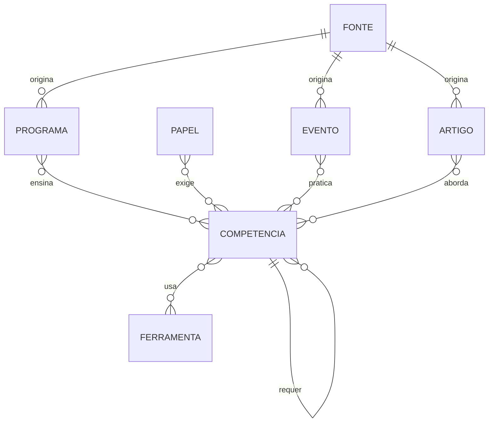

# Modelo canônico do ecossistema

Estado: **proposta para validação**. Nada aqui foi implementado.

## Objetivo

Um mesmo conteúdo aparece em vários sites:

- vira **programa** no learn-tech;
- é citado como **ferramenta** no tools;
- aparece ligado ao **papel de carreira** que o usa no career;
- aparece ligado ao **evento** que praticou aquela habilidade no bootcamps.

Hoje cada site tem seu formato próprio em `content/<site>/`, e o único elo entre eles é o `cobertura.json`. Ele liga pastas do acervo antigo (`a-arquivos-e-livros`) a ids publicados.

A proposta é criar uma camada de **catálogo** com entidades únicas e relações entre elas. O formato que os sites consomem continua o mesmo.

## Princípios

1. **Aditivo.** Os schemas atuais (`src/schemas/*.ts`) e os endpoints `/v1/<site>/...` não mudam. O catálogo entra ao lado (estratégia *strangler fig*).
2. **Cada coisa existe uma vez.** Ids estáveis, em minúsculas com hífen (`slug`), e as relações apontam para eles.
3. **Vocabulário controlado.** As competências seguem uma lista fechada, ancorada nas áreas do ACM CS2023 e do SWEBOK v4 (as duas referências que o `cobertura.json` já cita).
4. **O build valida.** Integridade referencial, ausência de ciclos nos pré-requisitos e regras de direitos e privacidade são conferidas antes do deploy, como já acontece com ids e quizzes.
5. **Fonte fora do git.** O original fica no `hd`, no computador do Douglas. O catálogo guarda só o id, o caminho relativo e, quando houver, o link do YouTube ou do Drive.

## Entidades

| Entidade | Id | Campos principais | De onde vem hoje |
|---|---|---|---|
| **Competência** | `slug` (ex.: `git`, `javascript`, `levantamento-de-requisitos`) | nome, área (ACM/SWEBOK), descrição, tipo (`hard` ou `soft`), pré-requisitos (ids de competência) | Não existe; implícita nas categorias dos programas |
| **Ferramenta** | `slug` (ex.: `figma`, `github`) | nome, site, competências que apoia | `content/tools/ferramentas.json` (56 itens, chave = `title`) |
| **Papel** | `slug` (ex.: `dev-frontend`, `product-owner`, `ux-designer`, `qa`) | nome, descrição, competências exigidas com nível | Não existe; o career tem perfis, vagas e empresas, mas não papéis |
| **Programa** | `id` numérico atual | competências ensinadas com nível de Bloom, pré-requisitos, fontes | `content/learn-tech/programas/{id}.json` (34; 4 completos) |
| **Evento** | `slug` atual | competências praticadas, fontes (fotos, vídeo) | `content/bootcamps/eventos/{slug}.json` (21) |
| **Artigo** | `slug` | tipo (resumo de livro, guia, estudo de caso), competências, fontes citadas | Não existe. Destino a validar: blog do learn-tech ou seção do career |
| **Fonte** | `DOC-nnn` ou `EV-nnn` (ids dos inventários) | caminho no `hd`, tipo, direitos, dados pessoais, estado, links externos | `cobertura.json` (20 itens, acervo antigo) |

### Direitos de uma fonte

| Valor | Significa | O que se pode publicar |
|---|---|---|
| `proprio` | Produzido pelo Douglas | O conteúdo, tratado (fotos em WebP sem EXIF) |
| `terceiro-citavel` | Livro, apostila, vídeo, curso ou texto de outra pessoa | Artigo próprio, trechos curtos citados com autor e obra, resumo breve. Nunca o arquivo |
| `sensivel-anonimizar` | Tem dados de terceiros, clientes ou processos reais | Só a lição, com nomes fictícios e sem dados identificáveis |
| `descartar` | Lixo técnico (ex.: log de driver) | Nada |

### Estado de uma fonte

`bruto` → `triado` → `catalogado` → `roteirizado` → `revisado` → `publicado`

## Relações

| Relação | De | Para | Atributo |
|---|---|---|---|
| ensina | Programa | Competência | nível (Bloom: lembrar, entender, aplicar, analisar, avaliar, criar) |
| exige | Papel | Competência | nível esperado |
| usa | Competência | Ferramenta | — |
| pratica | Evento | Competência | — |
| aborda | Artigo | Competência | — |
| origina | Fonte | Programa, Evento ou Artigo | — |
| requer | Competência | Competência | pré-requisito; forma um grafo acíclico dirigido |



## Arquivos propostos

Novos arquivos, sem tocar nos atuais:

```
content/catalogo/
  competencias.json   # vocabulário controlado + pré-requisitos
  papeis.json         # papéis de carreira + competências exigidas
  vinculos.json       # programa/evento/ferramenta/artigo -> competências
  fontes.json         # evolução do cobertura.json, apontando para o hd
```

A chave da ferramenta passa a ser um `slug` só dentro do catálogo. O `ferramentas.json` continua igual, e o vínculo usa o `title` atual até haver um id próprio.

Endpoints novos, só de leitura e gerados pelo build:

- `/v1/catalogo/competencias.json`
- `/v1/catalogo/competencias/{slug}.json`, com tudo o que se liga àquela competência nos 4 sites;
- `/v1/catalogo/papeis.json`.

## Projeções

| Fase | O que muda | Risco |
|---|---|---|
| 1 | O build lê o catálogo, valida e publica `/v1/catalogo/*`. Os sites continuam lendo `/v1/<site>/...` sem mudança | Nenhum para os sites |
| 2 | Os sites passam a ler, como campo **opcional**, links cruzados ("ensinado em…", "usado por…", "praticado no evento…") | Baixo: campo ausente não quebra a tela (fallback local, ADR 5) |
| 3 | O `cobertura.json` é substituído por `fontes.json` | Só depois de migrar os 20 itens |

## Validações do build

1. Todo id citado em `vinculos.json`, `papeis.json` e `fontes.json` existe.
2. **Pré-requisitos sem ciclo.** Ordenação topológica de Kahn sobre `requer`; se sobrar nó com grau de entrada maior que zero, há ciclo e o build falha. A mesma ordenação gera a sequência das trilhas.
3. Fonte `sensivel-anonimizar` só aparece ligada a item publicado com a marcação `anonimizado: true`.
4. Fonte `terceiro-citavel` nunca aponta para arquivo em `media/`, só para artigo.
5. Fonte `descartar` não tem destino.
6. Toda competência usada tem ao menos um programa ou artigo planejado (alerta, não erro).

## Vocabulário inicial

Tirado das 10 categorias do learn-tech e das categorias do tools e do career. A lista é uma proposta e fecha só depois de validada.

| Área | Competências |
|---|---|
| Fundamentos | `logica-de-programacao`, `algoritmos`, `estruturas-de-dados` |
| Web | `html`, `css`, `responsividade`, `javascript`, `acessibilidade` |
| Frontend | `react`, `nextjs`, `vue`, `gerenciamento-de-estado`, `tailwind` |
| UX/UI | `ux-research`, `prototipacao`, `figma`, `design-system`, `cores-e-tipografia` |
| Backend | `apis-rest`, `nodejs`, `python`, `docker`, `microsservicos` |
| Banco de dados | `sql`, `nosql`, `modelagem-de-dados`, `postgresql`, `mongodb`, `seguranca-de-dados` |
| Produto | `levantamento-de-requisitos`, `mvp`, `backlog`, `metricas-de-produto` |
| Projetos | `scrum`, `kanban`, `git`, `lideranca-tecnica` |
| Qualidade | `testes-automatizados`, `ci-cd` |
| Inglês | `ingles-tecnico` |
| IA | `programacao-com-ia` |
| Carreira | `processo-seletivo`, `leitura-de-vagas`, `rotina-e-produtividade`, `networking`, `lgpd` |
| Dados | `excel` |

## Exemplo de uma competência atravessando os 4 sites

Usando a competência `git`:

- **learn-tech:** programa 604, "Git e GitHub Workflow" (hoje é só a capa, sem módulos).
- **tools:** as 4 ferramentas da categoria "Versionamento".
- **career:** os papéis `dev-frontend` e `dev-backend` a exigem no nível "aplicar".
- **bootcamps:** os eventos que a praticaram. Isso depende dos inventários.
- **API:** `/v1/catalogo/competencias/git.json` devolve tudo isso numa resposta só.

## Ajustes vindos dos contratos

Quatro divergências encontradas em `02-contratos.md` (seção 4) afetam este modelo:

| Divergência | Efeito no modelo |
|---|---|
| D1: `status` do programa existe só no frontend | Antes de ligar a API no learn-tech, `status` precisa entrar no schema e em `CAMPOS_RESUMO`. Sem isso, as 30 capas viram links para uma página vazia. É pré-requisito da fase 2 e **precisa de validação** |
| D5: 94 `thumb` em `./assets/` dos sites | Uma imagem de ferramenta ou empresa só pode ser reaproveitada por outro site se estiver em `/media/`. Migrar é pré-requisito dos links cruzados (fase 2) e **precisa de validação** |
| D7 e D8: nomes e ids diferentes por site | O catálogo usa `slug` próprio e guarda o id legado de cada recurso (`id` numérico do programa, `slug` do evento, `title` da ferramenta e da empresa). Assim os contratos ficam como estão |
| D2 e D3: campos e páginas sem validação | O build do catálogo só confere o que o catálogo cria. Os campos que as telas já leem podem ser declarados como opcionais no schema; isso é aditivo e seguro, mas deve ser confirmado rodando o build |
