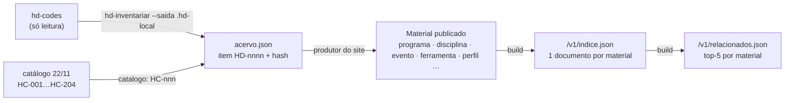

# API de conteúdo: do hd-codes aos 4 sites (desenho, 23/11/2026)

**Status:** proposta. Nada aqui mudou o schema nem a API publicada. As mudanças de schema e as rotas novas pedem a ordem do responsável (decisão 120 e ADR 3).

**Pergunta:** como os 204 itens do catálogo do hd-codes (22/11) viram conteúdo da API, e como os 4 sites acham e recomendam esse conteúdo com um algoritmo simples, barato e medível?

## 1. O que já existe (e não muda)
- **A leitura é estática:** `scripts/build.ts` valida `content/*.json` com Zod e gera `dist/v1/**.json`, servido pelos Static Assets com cache de 5 minutos (`cache-e-versionamento.md`). O Worker só atende escrita (acessos e mensagens) e saúde. **O desenho mantém isso:** busca e recomendação são geradas no build, e não custam invocação de Worker.
- **O acervo** (`content/acervo.json`, schema `acervo.ts`) guarda o caminho de cada item do hd por hash, tipo e tamanho, nunca pelo nome do arquivo. Os estados são novo → extraido → triado → planejado (A1) → produzido → publicado → exibido.
- **O tipo `disciplina`** (`disciplina.ts`, #47) existe, mas `dist/v1/learn-tech/disciplinas.json` ainda está vazio (`[]`).
- **O contrato é `/v1`:** campo novo entra como opcional, e nada se renomeia nem se remove.

## 2. Modelo de dados
Há 3 camadas. A de baixo é privada (o hd), a do meio é o registro e a de cima é o que os sites leem.

| Entidade | Onde mora | Campos novos (todos opcionais) | Para quê |
|---|---|---|---|
| **Item do acervo** | `acervo.json` | `catalogo: "HC-051"` | liga o registro ao catálogo de 22/11 sem pôr o nome do arquivo no git |
| **Material** (o recurso que já existe: programa, disciplina, evento, ferramenta, empresa, perfil, vaga) | o JSON de cada site | `assuntos: string[]` (lista fechada, ver abaixo), `nivel` (onde não houver), `sequencia: {anterior?, proximo?}` | busca, filtros e "continue daqui" |
| **Assunto** | `content/assuntos.json` (novo) | `slug`, `nome`, `sinonimos[]`, `pai?` | vocabulário único dos 4 sites; os sinônimos alimentam a busca ("ED" → estrutura de dados) |
| **Documento de índice** | gerado no build, não editado | `id` (`tipo:id`), `site`, `tipo`, `titulo`, `resumo` (até 160 caracteres), `assuntos[]`, `nivel?`, `url`, `atualizadoEm` | uma linha por material, para buscar e recomendar |

**Por que a lista de assuntos é fechada:** com texto livre, "React", "react.js" e "ReactJS" viram 3 assuntos, e a recomendação erra. Um teste do build falha se um material usar um assunto que não está em `assuntos.json`.

## 3. Endpoints
Todos são estáticos, gerados no build e com o mesmo cache de 5 minutos.

| Rota | Conteúdo | Tamanho estimado |
|---|---|---|
| `GET /v1/indice.json` (nova) | os documentos de índice de todos os sites | cerca de 250 B por material: 600 materiais dão cerca de 150 kB, ou 30 kB com gzip |
| `GET /v1/assuntos.json` (nova) | o vocabulário, com sinônimos | menos de 10 kB |
| `GET /v1/relacionados.json` (nova) | `{ "<tipo:id>": ["<tipo:id>", …5] }`, já calculado | cerca de 60 B por material |
| `GET /v1/learn-tech/disciplinas.json` e `/disciplinas/<slug>.json` (já previstas no #47) | card e página da disciplina | — |
| As rotas atuais (`programas`, `eventos`, `ferramentas`…) | não mudam; só ganham os campos opcionais | — |

**Sem busca no servidor:** com até cerca de 2 mil materiais, o índice inteiro cabe num pedido de menos de 100 kB com gzip, e a busca roda no navegador em menos de 5 ms. Uma rota `/v1/busca?q=` no Worker só vale a pena se o índice passar de cerca de 1 MB. Com o plano gratuito, ela consumiria a cota de 100 mil invocações por dia.

**Eficiência no learn-tech:** o índice é baixado sob demanda, quando a pessoa abre a busca, nunca na entrada. A entrada está em 278,5 kB, com teto de 285 kB.

## 4. Como o catálogo de 22/11 vira registros
| O catálogo diz ("vira") | Itens | Vira o recurso | Site |
|---|---|---|---|
| 1 página de disciplina | 88 | `disciplina` (1 por disciplina; os capítulos ficam dentro dela) | learn-tech |
| 1 aula da trilha | 15 | módulo de um programa da trilha "Fundamentos da web" | learn-tech |
| 1 relato de programa | 13 | `programa` (diário de bootcamp) | learn-tech |
| 1 indicação · indicação ou post · só link | 45 | `ferramenta` ou leitura | tools |
| 1 cobertura · página + bastidores | 9 | `evento` | bootcamps |
| 1 guia · contexto do curso | 15 | perfil, guia ou modelo | career |
| triagem · não sai · não usa | 5 | só o registro no acervo (`referencia` ou `nao-publicavel`) | — |
| outros (modelos, templates, repositórios) | 14 | o recurso do destino que o catálogo indica, decidido na triagem | vários |

**O caminho de um item:**
1. `node scripts/hd-inventariar.mjs --hd D:\douglasabnovato\hd-codes --saida .hd-local --ignorar 4-experiences --registrar` cria os itens `HD-nnnn` com hash, sem escrever no hd.
2. O triador preenche `catalogo: "HC-nnn"`, `direitos` e a `triagem`.
3. Na aprovação A1, o autor aprova o plano, e o item passa a `planejado`.
4. O produtor do site grava o material com `assuntos` e o acervo passa a `produzido`. Depois do merge e do deploy, passa a `publicado`.
5. O aviso "pronto: HC-nnn" sai, e o autor move a pasta para a `000-catalogado`.

**Ritmo:** 2 itens por dia útil, e na `5-expertise` 1 capítulo por turno (`padrao-disciplina-5-expertise`).

## 5. Busca: o algoritmo
**BM25 por campo, no navegador, sobre `indice.json`.**

1. **Normalizar:** minúsculas; sem acentos (NFD sem as marcas); separar por tudo o que não for letra ou número; tirar as palavras vazias em português ("de", "a", "o", "para"…); trocar os sinônimos de `assuntos.json` pelo slug.
2. **Indexar** (uma vez, ao abrir a busca): um índice invertido `termo → [(documento, campo, frequência)]`.
3. **Pontuar:** BM25 (k1 = 1,2, b = 0,75), com peso por campo: título ×3, assuntos ×2 e resumo ×1. O último termo digitado também casa por prefixo ("estru" acha "estrutura"), para a busca responder enquanto a pessoa digita.
4. **Tolerar um erro:** se der 0 resultados, repetir com distância de edição ≤ 1 para termos de 5 letras ou mais ("pilah" → "pilha").
5. **Desempatar:** pelo mesmo site, depois pelo mais recente.

**O custo:** montar o índice é O(total de termos), cerca de 15 mil para 600 materiais. Uma consulta é O(soma das listas dos termos), muito abaixo de 1 ms. O código cabe em cerca de 2 kB, sem biblioteca.

## 6. Recomendação: "relacionados" e "continue daqui"
**Calculada no build, sem dado pessoal.** Só o conteúdo decide; não se usa histórico de quem navega.

1. **Vetor do material:** TF-IDF dos assuntos (peso 2) e dos termos do título (peso 1).
2. **Similaridade:** cosseno entre todos os pares. Com N = 600, são 180 mil pares, menos de 1 s no build.
3. **Regras, nesta ordem:**
   - `sequencia.proximo` vem primeiro (o capítulo ou a disciplina seguinte, como a DCC012 depois da DCC013);
   - o mesmo nível ou um acima;
   - no máximo 3 do mesmo site entre os 5, para levar a pessoa de um site a outro (do learn-tech ao tools, por exemplo).
4. **Diversidade (MMR, λ = 0,7):** cada escolhido é o que maximiza 0,7 × a similaridade com o material − 0,3 × a maior similaridade com os já escolhidos. Assim, os 5 não são variações do mesmo tema.
5. **Saída:** `relacionados.json`. O site mostra os 5 no fim da página do material.

**Por que não filtragem colaborativa:** ela exige histórico por pessoa. Os acessos guardados no D1 têm nome e e-mail, e a política de privacidade não prevê esse uso. O conteúdo basta para o tamanho atual.

## 7. Como medir
| O que | Métrica | Como | Meta |
|---|---|---|---|
| Busca, offline | MRR@5 e nDCG@5 | `tests/busca-gabarito.json`: 30 consultas reais com o resultado esperado, escritas pelo produtor e aprovadas pelo autor; teste no Vitest a cada build | MRR@5 ≥ 0,8; o build falha se cair mais de 0,05 |
| Busca, offline | tempo | consulta no índice de 600 materiais, no Vitest | < 5 ms |
| Recomendação, offline | precisão@5 | 20 materiais sorteados; o autor marca cada um dos 5 como "faz sentido" ou "não faz" | ≥ 0,7 |
| Recomendação, offline | cobertura | % dos materiais que aparecem em algum "relacionados" | ≥ 80% (sem material órfão) |
| Recomendação, offline | diversidade | média de sites diferentes entre os 5 | ≥ 1,8 |
| Uso, online (fase 3) | CTR de "relacionados" e % de buscas sem clique | contagem agregada por dia, sem identificar ninguém: pede uma rota de escrita nova e a ordem do responsável | definir depois de 4 semanas de base |

## 8. Fases
| Fase | Entrega | Escritas de schema | Tamanho |
|---|---|---|---|
| 1 | `assuntos.json` + campo `assuntos` opcional + teste de vocabulário; `indice.json` no build | sim (ordem do responsável) | M |
| 2 | busca BM25 no learn-tech (sob demanda) + gabarito de 30 consultas | não | M |
| 3 | `relacionados.json` + bloco "relacionados" no learn-tech; depois nos outros 3 sites | não | M |
| 4 | `catalogo: HC-nnn` no acervo + inventário do hd-codes com `--saida .hd-local` | sim | P |
| 5 | métrica online agregada (CTR) | sim, rota nova | G |

## 9. Decisões para o responsável
1. Adotar a lista fechada de assuntos e o campo opcional `assuntos` em todos os recursos (fase 1).
2. As 3 rotas estáticas novas em `/v1` (`indice`, `assuntos` e `relacionados`).
3. O campo `catalogo` no item do acervo (fase 4).
4. Se a métrica online entra (fase 5) e, se entrar, com que texto na política de privacidade.
