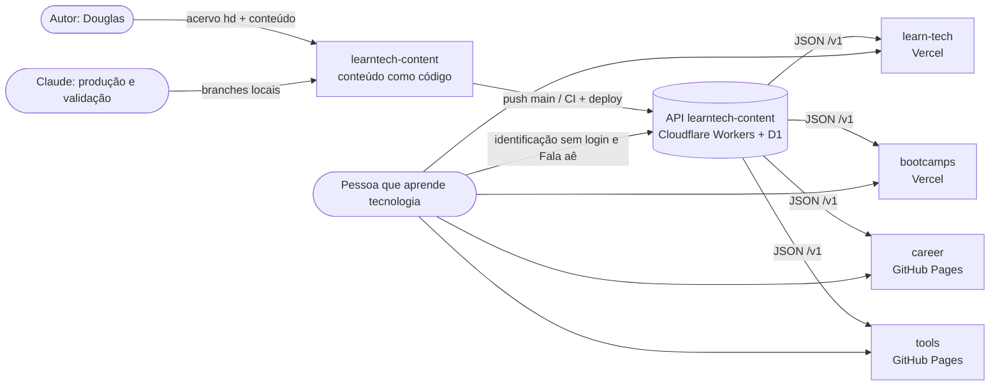
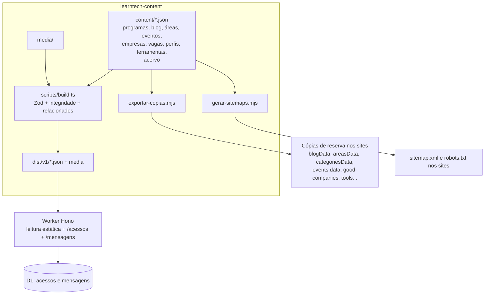

# Arquitetura do ecossistema learnTECH

Visão de conjunto da API e dos quatro sites. Os detalhes internos da API estão em `../ARQUITETURA.md`; as decisões, em `../DECISOES.md` (ADRs 1 a 8); a documentação de cada site, em `<site>/docs/README.md`.

## Contexto

## Containers

## Contratos entre a API e os sites
| Recurso `/v1/...` | Schema (`src/schemas`) | Consumido por | Reserva local |
|---|---|---|---|
| `learn-tech/programas.json`, `learn-tech/programas/<id>.json` | `learn-tech.ts` | learn-tech (`useApi`) | `programsData.js` (manual e defasada) |
| `learn-tech/paginas/<nome>.json` (blog, categorias, sobre...) | `learn-tech.ts` | learn-tech (`usePagina`) | `blogData.js`, `categoriesData.js` (geradas) |
| `learn-tech/areas.json` | `learn-tech.ts` | learn-tech | `areasData.js` (gerada) |
| `bootcamps/eventos.json`, `bootcamps/eventos/<slug>.json` | `bootcamps.ts` | bootcamps (`eventApi`) | `events.data.ts` (gerada) |
| `career/empresas.json`, `vagas.json`, `perfis.json`, `destaques.json`, `modelos-curriculo.json` | `career-tools.ts` | career (`catalog.js`) | `js/*.js` (geradas) |
| `tools/ferramentas.json`, `tools/hospedagens.json` | `career-tools.ts` | tools (`api.js`) | `data/*.js` (geradas) |

**Regras do contrato:**
- **Versionamento:** a API é versionada em `/v1`. Mudança que quebra consumidor exige `/v2` ou campo opcional novo; nunca renomear ou remover campo em `/v1`.
- **Ligações entre projetos:** `relacionados` entra no conteúdo como `{tipo, id}`. O build confere se o alvo existe e publica `projeto`, `titulo` e `url`, de modo que os sites não montam URL de outro site.
- **Mídia:** `/media/...` é relativa à API; cada site resolve para URL absoluta (`resolverMidia`).
- **Disponibilidade:** os sites funcionam sem a API, com a cópia de reserva (ADR 5). Por isso, toda mudança de conteúdo termina com `npm run copias`.
- **Tipos espelhados:** o schema Zod da API é a fonte. O tipo TypeScript do bootcamps e os testes de contrato da career e do tools acompanham.

## Fluxo de uma mudança de conteúdo
1. O conteúdo entra em `content/` (branch do dia, criada a partir da `main`).
2. `npm run validar`, `cobertura`, `leva:status`, `copias`, `sitemaps` e `progresso`.
3. O autor roda `npm run verificar`, faz commit, merge na `main` e push.
4. A CI testa e o deploy publica a API. Os sites atualizam a cópia e o sitemap no próprio push.

## Riscos conhecidos e tratamento
| Risco | Tratamento |
|---|---|
| API fora do ar | Cópias de reserva; categorias passaram a ser geradas em 01/11. Falta gerar a de programas. |
| Conteúdo com dado sensível | Regras em `docs/processo/seguranca-privacidade.md`, varredura de nomes e marcas e revisão independente por amostra. |
| Contrato divergente entre o schema e o tipo dos sites | Testes de contrato nos sites (bootcamps, career e tools) e espelhamento manual documentado. |
| Deploy sem conferência | CI obrigatória antes do merge (pendente de ativação no GitHub) e checagem por curl depois do deploy. |
